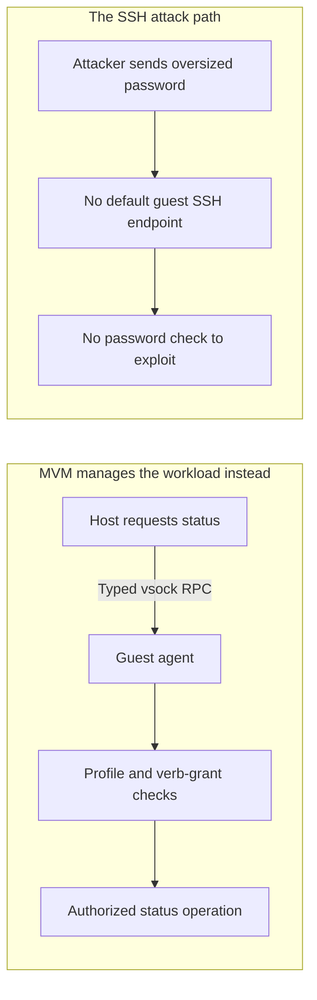

You create a deployment account, give it an SSH public key, and leave it without a usable password. The intention is straightforward: someone holding the private key can log in; someone guessing passwords cannot.

On an affected Alpine Linux server, that account could instead accept a password consisting of 300 `A` characters. No stolen key. No cracked hash. Just a password that should never have worked.

That is the failure addressed by [OpenSSH 10.6p2](https://www.openssh.org/releasenotes.html#10.6p2), released November 5, 2026. It is also a useful example of what AI-assisted security research changes: not the existence of subtle bugs, but the cost of searching the combinations in which they become exploitable.

## AI found the combination, not a weakness in encryption

In his [disclosure](https://sshhole.com/), Özgün Kültekin of Wakefield describes building OpenSSH across different C libraries, authentication configurations, and password-storage arrangements. He reports using AI agent swarms to exercise about 17,600 unusual login tests: malformed hashes, broken accounts, oversized passwords. Most configurations agreed about which attempts to reject. One combination—musl libc without PAM—accepted attempts it should have refused.

The OpenSSH maintainers put that discovery in a wider context. Their release notes say they have seen security bugs identified by AI tools subsequently rediscovered by independent researchers:

> This suggests that adversaries who do not report bugs to OSS projects are likely to be able to discover these bugs too.

Their response is more frequent releases, so fixes reach users sooner. That is not evidence that this particular bug has been exploited in the wild. It is a warning against assuming that an obscure interaction will stay obscure.

For an operator, the problem now has two parts: deploy fixes faster, and reduce the number of services whose next authentication bug could become a way into a workload.

## How an error became a successful login

Normally, an SSH password check does not compare the supplied password with a stored plaintext secret. It hashes the attempt using the account's stored hashing parameters and compares the result with the stored hash.

An account intended for key-only access can have `*` in its password field instead. That is not a real password hash. No password should match it. Crucially, **an account with no usable password is not the same as a server with password authentication disabled**: the server may still accept password attempts, even though this account should reject every one.

On the affected non-PAM path, OpenSSH still performs a hashing operation when the account's field is too short to supply hashing parameters. It borrows those parameters from another account, a behavior introduced to reduce timing differences that could reveal which usernames exist.

Then two meanings of the same character collide. musl's password-hashing function, `crypt()`, returns `*` as an error indicator when the relevant hashing operation receives a password longer than 256 bytes. The target account's stored field is also `*`. The old comparison sees identical strings:

**Stored “no usable password” marker: `*`. Hashing error result: `*`. Comparison: equal.**

A failed hashing operation has become evidence of a correct password.

[Alpine's advisory](https://alpinelinux.org/posts/2026-11-05-openssh-password-authentication-bypass/) spells out the conditions: a reachable affected SSH server using musl without PAM, password authentication enabled, a target account with `*` as its password field, and another local account with a `$5$` or `$6$` password hash. In that configuration, a password between 257 and 1,024 bytes can produce a successful login. Alpine describes a single-connection attack that needs no guessing or retries.

This does not break SSH encryption or forge a public-key signature. It goes around the key requirement by making a different authentication method incorrectly succeed.

## Why that is a big deal

The damage depends on the account that opens up. A deployment user might be able to modify application code or read configuration. A more privileged account can turn a login into control of the machine.

Alpine gives a concrete example: affected official tiny-cloud images ship an `alpine` user with a `*` password field and passwordless `doas`, allowing that user to become root. Those images are not exploitable at first boot merely because the account exists. But adding a qualifying password hash elsewhere—for example, by setting a console password—can complete the vulnerable configuration. An administrator can expose a supposedly key-only account without changing that account at all.

That is what makes the bug more troubling than “someone chose a weak password.” The target need not have a password to steal. The failure comes from a composition of otherwise familiar choices: a minimal Linux distribution, non-PAM authentication, a key-only account, and an error convention in a library.

The [OpenSSH fix](https://github.com/openssh/openssh-portable/commit/4353fdc43ef646c43a8dda7025cc1a898caf1482) adds a minimum stored-hash length check before accepting that comparison. The project calls it a workaround for a root cause outside `sshd`. For an affected operator, the immediate action is to install 10.6p2 or the distribution's backported fix **and restart the daemon**. Alpine also documents disabling password authentication and restarting as an interim mitigation.

But after fixing this login path, it is worth asking why a workload needs the path at all.

## MVM removes the SSH entry point this attack needs

Imagine that deployment account existed because you needed to start a worker, check whether it was healthy, and inspect a failed run. SSH provided a convenient way to do those jobs, so the VM carried an administrative login service alongside the application.

MVM keeps the jobs and removes that dependency.

When the host asks an MVM guest for its status, the request goes to the guest agent over **vsock**: a host–guest communication channel, not an IP connection to an SSH daemon. The agent receives a typed request for a particular operation. It does not ask for a Unix account's password or hand back an SSH session.

Now follow the attack from the outside. The attacker wants a reachable `sshd` to which they can submit that oversized password. A normal MVM workload has no network interface and no routable guest IP, and MVM does not require an SSH server for management. There is no default guest SSH endpoint waiting for the attempt. This isn't port 22 moved to a less obvious number; the management workflow no longer uses SSH.

*The SSH attempt has no entry point into the standard workload. Legitimate management uses a separate host–guest channel, not a password login. This assumes no custom SSH service has been published; host SSH is outside this diagram.*

Nor is the replacement intended to be an unrestricted shell with a different transport. In the sealed-production profile, the guest agent rejects development-only requests such as arbitrary `Exec` and console operations. Profile checks and verb grants constrain the control API. That API still needs security review and updates, but this particular Unix-password comparison is not part of it.

The [networking guide](/guides/networking/#no-ssh) and [vsock reference](/reference/vsock-messages/) describe those paths. The direct mitigation here is **removing the vulnerable login service from workload management**, not claiming that a microVM can recognize a malicious password.

## Follow the network boundary one step further

The worker may still need to call an API, and a web workload may still need to receive requests. No NIC does not mean no useful networking.

For outbound traffic, the guest asks a host-owned endpoint to open a connection. FlowMux carries the request over vsock; the host checks the destination against the signed plan before opening the external socket. Egress defaults to deny-all. For inbound traffic, the operator explicitly declares a host listener and the guest-loopback service it will reach. Granting outbound access does not silently publish an inbound port.

This separates two protections that are easy to blur together:

| Attacker's next move | Where MVM changes the path |
|---|---|
| Submit the oversized password to a workload's administrative SSH service | Normal workload management uses the guest agent, not SSH, and exposes no default guest SSH route |
| Try to use the replacement control API as a general-purpose shell | The sealed-production profile rejects arbitrary `Exec` and console requests; verb grants further limit operations |
| After a guest compromise, connect to another machine | No guest NIC; the host-owned endpoint enforces the admitted egress policy |

## A smaller attack surface for the next discovery

As AI makes it easier to uncover overlooked interactions, keeping up cannot depend only on patching faster. It also means giving attackers fewer entry points to try. MVM lets operators manage workloads without making each one a remotely accessible SSH server: typed vsock requests handle management, production profiles narrow the available operations, and host-owned policy controls network access. For this bug, the benefit is concrete—the standard workload has no SSH login path through which to submit the malicious password. For the next discovery, the same design leaves fewer exposed services and more explicit limits on what a workload can reach.

## Sources

- [OpenSSH 10.6p2 release notes](https://www.openssh.org/releasenotes.html#10.6p2)
- [Researcher's disclosure: mechanism and AI-assisted discovery](https://sshhole.com/)
- [Alpine Linux advisory: affected configurations, cloud images, and remediation](https://alpinelinux.org/posts/2026-11-05-openssh-password-authentication-bypass/)
- [OpenSSH authentication-bypass fix](https://github.com/openssh/openssh-portable/commit/4353fdc43ef646c43a8dda7025cc1a898caf1482)
- [MVM networking: no SSH, declared ingress, and default-deny egress](/guides/networking/)
- [MVM vsock message reference](/reference/vsock-messages/)
- [MVM security architecture and trust boundaries](/security/matryoshka/)
